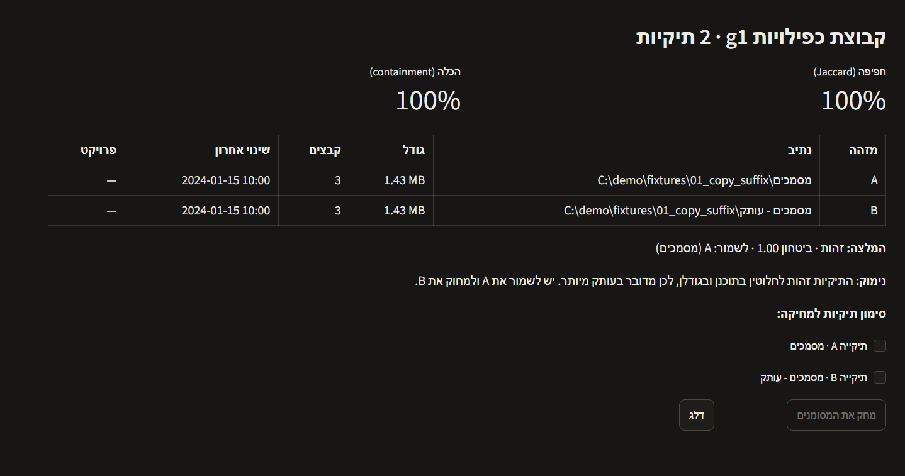
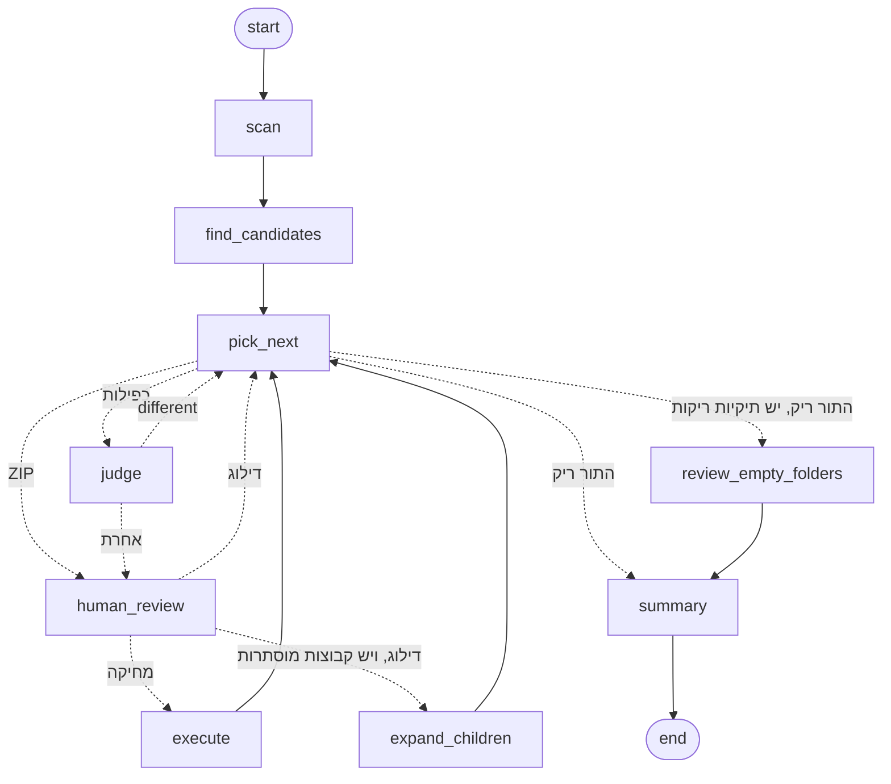
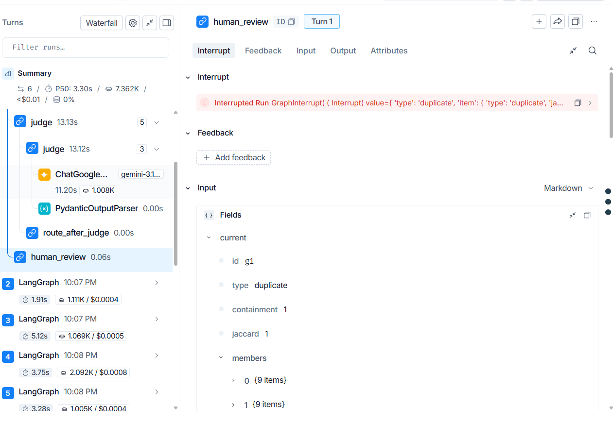
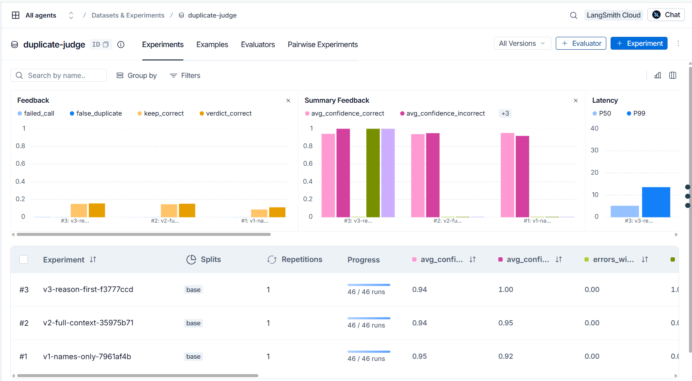
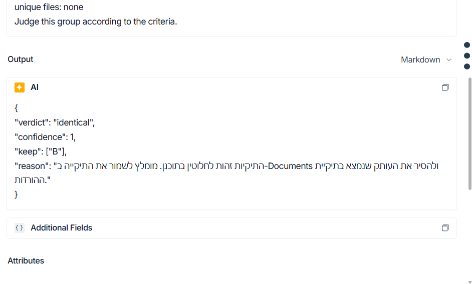
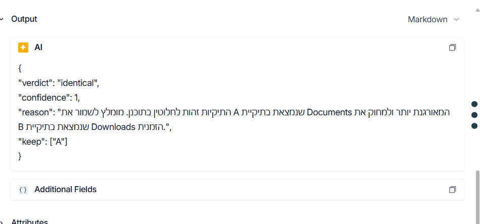

# איתור תיקיות כפולות עם אישור אנושי (LangGraph)

אפליקציה מקומית ל-Windows שסורקת תיקיות שהמשתמשת בוחרת ומאתרת בהן שלושה סוגי פריטים:
- **תיקיות כפולות:** זהות, או עותק עם שינויים.
- **קובצי ZIP שכבר חולצו:** במלואם או חלקית.
- **תיקיות ריקות.**

כל פריט מוצג לאישור לפני שהוא מועבר לסל המחזור. מודל שפה (Gemini) ממליץ איזה עותק לשמור, אבל ההחלטה תמיד בידי המשתמשת.

הפרויקט הוגש כעבודה בקורס. הוא ממלא את הדרישות הבאות:
- **LangGraph:** הגרף כולל לולאה, הסתעפויות מותנות ו-interrupt.
- **Checkpointer:** SqliteSaver, כדי שאפשר יהיה להמשיך אחרי סגירה.
- **הערכה אוטומטית ב-LangSmith:** ניסוי לפני ואחרי שיפור.
- **README:** עם צילומי traces ותובנה שעלתה מהם.

**מסמכים נוספים:**
- [האפיון המלא (docs/SPEC.md)](docs/SPEC.md)
- [כל הממצאים מתהליך הפיתוח (docs/findings.md)](docs/findings.md)

> **הרצה מקומית בלבד.** האפליקציה רצה על המחשב שלך ומוחקת רק דרך סל המחזור. אין שרת ואין העלאה של קבצים.

---

## תוכן עניינים
1. [איך זה עובד](#איך-זה-עובד)
2. [הגרף](#הגרף)
3. [התקנה והרצה](#התקנה-והרצה)
4. [אמצעי בטיחות](#אמצעי-בטיחות)
5. [פרטיות](#פרטיות)
6. [הערכה: שלושה ניסויים](#הערכה-שלושה-ניסויים)
7. [התובנה המרכזית מה-traces](#התובנה-המרכזית-מה-traces)
8. [ממצאים נוספים](#ממצאים-נוספים)
9. [מגבלות ההערכה](#מגבלות-ההערכה)
10. [מגבלות ידועות](#מגבלות-ידועות)
11. [צילומי מסך](#צילומי-מסך)
12. [מבנה הפרויקט](#מבנה-הפרויקט)

---

## איך זה עובד

1. **סריקה (בלי LLM):**
   - הסורק עובר על התיקיות, מדלג על תיקיות מערכת ועל קבצים מוסתרים, ולא מוריד קובצי OneDrive שנמצאים רק בענן.
   - הוא מחשב SHA-256 רק לקבצים שיש להם קובץ אחר באותו גודל בדיוק.
2. **השוואת תיקיות לפי תוכן:**
   - לכל תיקייה נבנה אוסף ה-hash של כל הקבצים שלה, בכל עומק.
   - שני מדדים: Jaccard (משותף / איחוד) ו-containment (משותף / התיקייה הקטנה).
   - משווים רק תיקיות שחולקות לפחות hash אחד (אינדקס הפוך).
   - כל תיקייה נשארת רק בזוג עם השותף הטוב ביותר שלה. כך לא נוצרים זוגות צולבים כמו "אתר" ↔ "אתר גיבוי\תמונות".
3. **הצגת התיקייה העליונה בלבד:** כפילות שנמצאת כולה בתוך כפילות גדולה יותר מוסתרת. היא נחשפת רק אם המשתמשת מדלגת על הקבוצה הגדולה.
4. **זיהוי פרויקטים:** לכל תיקייה בקבוצה נבדק אם היא בתוך פרויקט, כלומר תיקיית אב שמכילה html, `.csproj`, `.sln`, `package.json` או `requirements.txt`.
5. **המלצת LLM (Gemini):**
   - רק לקבוצות כפולות, עם פלט מובנה (Pydantic) ו-validation.
   - ניסיון חוזר אחד. אם גם הוא נכשל, הפריט מוצג בלי המלצה.
6. **אישור אנושי לכל פריט:** כל פריט מוצג בממשק Streamlit בעברית (RTL), או ב-`cli.py` לצורכי דיבוג, והמחיקה מתבצעת רק אחרי אישור.



כרטיס כפילות בממשק (קבוצה g1, תיקיות הבדיקה): טבלת חברי הקבוצה, חפיפה (Jaccard) והכלה (containment) של 100%, ההמלצה ("זהות, ביטחון 1.00, לשמור: A"), הנימוק, ותיבות הסימון לבחירת התיקיות למחיקה.

---

## הגרף

נוצר מ-`get_graph().draw_mermaid()`. לחצים מקווקווים הם מעברים מותנים.



- **לולאה:** `pick_next`, משם `judge` ו-`human_review`, משם `execute` או `expand_children`, וחזרה ל-`pick_next`.
- **interrupt:** ב-`human_review` (פריט אחד) וב-`review_empty_folders` (כל התיקיות הריקות במסך אחד).
  - בצמתים האלה אין שום פעולה עם השפעה לפני `interrupt()`, כי הצומת רץ מההתחלה כשממשיכים.
  - מחיקה וכתיבה ליומן קורות רק ב-`execute` וב-`review_empty_folders`, אחרי שמתקבלת ההחלטה.
- **Checkpointer:** ‏`SqliteSaver` על הקובץ `checkpoints.sqlite`. אפשר לסגור את הדפדפן או את Streamlit, ולהמשיך מאותה נקודה לפי מזהה ההרצה.

---

## התקנה והרצה

הדרישות: Windows, ‏Python 3.11 ומעלה, מפתח API של Google (Gemini), ומפתח של LangSmith (רק לניסויים ול-traces).

```
python -m venv .venv
.venv\Scripts\activate
pip install -r requirements.txt
copy .env.example .env
```

ב-`.env` צריך למלא את `GOOGLE_API_KEY` ואת `LANGSMITH_API_KEY`. הקובץ לא נשמר ב-git.

**הרצת הממשק:**
```
streamlit run app.py
```
1. מדביקים בסרגל הצד נתיב של תיקייה, למשל `C:\Users\<שם משתמש>\Documents`.
2. לוחצים "התחל סריקה".
3. מזהה ההרצה מוצג בסרגל הצד. כדי להמשיך אחרי סגירה, מזינים אותו בשדה "המשך הרצה קודמת".

**תיקיות בדיקה עם כל המקרים המוכרים:**
```
python test_data\make_fixtures.py
```
הסקריפט מדפיס את הנתיב שנוצר בתיקייה זמנית, ואפשר להדביק אותו בממשק.

**הרצה בטרמינל (דיבוג):**
```
python cli.py <נתיב>
python cli.py --thread <מזהה הרצה>
```
השורה הראשונה מתחילה הרצה חדשה, והשנייה ממשיכה הרצה קיימת.

**בדיקות:**
```
python -m pytest
```
יש 72 בדיקות. הן לא קוראות ל-API ולא נוגעות בסל המחזור האמיתי.

**הערכה:**
```
python eval\make_dataset.py --upload
python eval\run_experiment.py
python eval\run_experiment.py --run v3 --reuse v1=<שם ניסוי v1> v2=<שם ניסוי v2>
```
1. השורה הראשונה מעלה את הדאטהסט ל-LangSmith.
2. השנייה מריצה את v1 ואת v2.
3. השלישית מריצה רק את v3 ומשווה אותו לניסויים הקיימים.

---

## אמצעי בטיחות

| אמצעי | פירוט |
|---|---|
| **רשימת דילוג** | לא נסרקות תיקיות כמו `Windows`, `Program Files`, `AppData`, `.git`, `node_modules`, `venv` (ההשוואה בלי תלות באותיות גדולות/קטנות), תיקיות וקבצים מוסתרים או של המערכת, קיצורי דרך, symlinks ו-junctions. |
| **OneDrive** | קבצים שנמצאים רק בענן לא נקראים, כדי לא להוריד אותם. |
| **סל המחזור** | כל מחיקה עוברת לסל המחזור (`send2trash`). אין מחיקה סופית. |
| **בדיקה חוזרת לפני מחיקה** | לפני כל מחיקה נבדק שהנתיב עדיין קיים, ושהגודל ומספר הקבצים לא השתנו מאז הסריקה. אם משהו השתנה, הפריט לא נמחק ומוצגת אזהרה. תיקייה ריקה נבדקת שוב שהיא עדיין ריקה. |
| **אישור לכל פריט** | אין מחיקה אוטומטית. אי אפשר למחוק את כל העותקים בקבוצה, ואף תיבה לא מסומנת מראש. |
| **מניעת מחיקה כפולה** | כל כפתור נושא את מזהה ה-interrupt שבשבילו הוצג. לחיצה כפולה, רענון או דף ישן לא מבצעים את ההחלטה פעמיים. |
| **"ריקה" רק כשהיא באמת ריקה** | תיקייה עם קובץ מוסתר, עם קובץ שנמצא רק בענן או עם תיקייה שדולגה לא נחשבת ריקה. |
| **יומן פעולות** | כל החלטה נרשמת ב-`logs/actions_log.csv`: מה נעשה, ההמלצה, ההחלטה, והאם ההחלטה תאמה להמלצה (`recommendation_outcome`). היומן לא נשמר ב-git, כי יש בו נתיבים אמיתיים. |

---

## פרטיות

ל-Gemini נשלחים **שמות ומטא-דאטה בלבד, אף פעם לא תוכן של קבצים**:
- שם התיקייה והנתיב המלא שלה.
- גודל, מספר קבצים ותאריך השינוי האחרון.
- עד 20 שמות של קבצים ייחודיים, עם הגדלים שלהם.
- אחוזי החפיפה.
- הנתיב של הפרויקט שהתיקייה נמצאת בו, אם יש כזה.

הנתיבים המלאים כוללים את שם המשתמש ב-Windows ואת שמות התיקיות. הרשימה הזו לא נשלחת לשום מקום אחר: קבצים, ZIP ותיקיות ריקות נבדקים מקומית בלי LLM.

---

## הערכה: שלושה ניסויים

ההערכה בודקת רק את פונקציית ה-judge. הקלט הוא נתוני קבוצה, והפלט הוא Judgement. הדאטהסט מכיל 46 דוגמאות סינתטיות במבנה הקלט של ה-LLM (`eval/dataset.json`), ולכל דוגמה יש verdict צפוי ורשימה של תשובות keep מקובלות:
- 22 זהות.
- 10 עותקים עם שינויים.
- 14 שונות.

**גרסאות הפרומפט:**
- **v1** (‏`v1-names-only`): רק שמות ונתיבים, והשאלה "האם אלה עותקים, ואיזה לשמור?".
- **v2** (‏`v2-full-context`): כל המטא-דאטה, יחד עם קריטריונים מפורשים:
  - שם של עותק אינו ראיה מכרעת.
  - עותק עם קבצים חדשים עשוי להיות הגרסה העדכנית.
  - מיקום נבחן רק לפי החלק השונה בנתיב.
  - כשהחברים בפרויקטים שונים, לשמור את כולם.
- **v3** (‏`v3-reason-first`, **ברירת המחדל**): v2, בתוספת שני שינויים. בסכמה, `reason` מופיע לפני `keep`, והנימוק חייב להזכיר את המזהים ("לשמור את A, למחוק את B").

| מדד | v1 | v2 | v3 |
|---|---|---|---|
| verdict_correct | 0.717 (33/46) | 0.978 (45/46) | 1.000 (45/45)* |
| keep_correct | 0.562 (18/32) | 0.938 (30/32) | 0.968 (30/31)* |
| false_duplicate (נמוך = טוב) | 0.000 | 0.000 | 0.000 |
| failed_calls | 0 | 0 | 1 (‏invalid_output) |
| ביטחון ממוצע, תשובות נכונות | 0.952 | 0.939 | 0.943 |
| ביטחון ממוצע, תשובות שגויות | 0.919 | 0.950 | 1.000 |
| טעויות עם ביטחון מתחת ל-0.7 | 0 מתוך 18 | 0 מתוך 2 | 0 מתוך 1 |

\* **הסתייגות לגבי v3:** העלייה ב-verdict_correct ל-1.000 **אינה שיפור אמיתי**. היא נובעת כולה מכך שדוגמה 21 עברה מ"טעות" ל"קריאה שנכשלה", וקריאה שנכשלה לא נספרת כטעות אלא בנפרד ב-`failed_calls`, כדי שכשלי רשת לא יעוותו את ההשוואה. גם ב-keep_correct, v2 ו-v3 צדקו באותו מספר דוגמאות (30). v3 תיקן את דוגמה 15 ושבר את דוגמה 18.

**הגדרות המדדים:**
- **verdict_correct:** האם ה-verdict תואם לצפוי.
- **keep_correct:** האם קבוצת ה-keep היא אחת מהתשובות המקובלות (לא נבדק בדוגמאות שהתשובה הצפויה בהן היא "שונות").
- **false_duplicate:** סיווג של תיקיות שונות כעותקים, הטעות המסוכנת ביותר. נמדד רק על הדוגמאות השונות.
- **failed_calls:** כשלים אחרי ניסיון חוזר, עם פירוט לפי סוג.
- **confidence_calibration:** הביטחון הממוצע בתשובות נכונות מול שגויות.

---

## התובנה המרכזית מה-traces

### תיקון פרומפט יצר מצב כשל חדש, וההערכה האוטומטית חשפה אותו

**הטעות.**
- **דוגמה 15:** החברים הם A = `Documents\חשבוניות - עותק` ו-B = `Downloads\חשבוניות`, והתשובה הצפויה היא לשמור את A, שנמצאת במיקום המסודר.
- **מה v2 החזיר:**

  ```
  reason: "התיקיות זהות לחלוטין בתוכנן. מומלץ לשמור את התיקייה ב-Documents
           ולהסיר את העותק שנמצא בתיקיית ההורדות."
  keep:   ["B"]
  confidence: 1.0
  ```

- **הנימוק נכון, אבל `keep` מצביע על החבר ההפוך.** משתמשת שקוראת את הנימוק וסומכת עליו תמחק את התיקייה הלא נכונה. בביטחון 1.0 לא מוצג אפילו באנר "המערכת לא בטוחה".

**הסיבה, כפי שנראתה ב-trace.**
- **הסדר בסכמה:** `keep` מופיע לפני `reason`, ולכן המודל בוחר מזהה לפני שהוא מנמק.
- **אין קישור בין השדות:** הנימוק מתייחס לתיקיות לפי המיקום ("ב-Documents") ולא לפי המזהה, כך שאין שום קישור מפורש בין הנימוק לבחירה.
- **ה-validation לא מכסה את זה:** הוא בודק שהמזהים קיימים, אבל לא שהם תואמים לנימוק.
- **מה הראה ה-trace:** רק הצגה של שני השדות זה לצד זה הראתה שהמודל "התכוון" לתשובה הנכונה.

**התיקון (v3).**
- בסכמה, `reason` הועבר לפני `keep`.
- נוספה הנחיה להזכיר בנימוק את המזהים של מה לשמור ומה למחוק.

**התוצאה.**
- ✅ **דוגמה 15 תוקנה:** "מומלץ לשמור את A שנמצאת בתיקיית Documents... ולמחוק את B", עם keep=A.
- ✅ **התאמה מלאה בין הנימוק ל-keep:** ב-v2, רק 2 מתוך 32 נימוקים הזכירו מזהים. ב-v3, 30 מתוך 32 הזכירו, וכל ה-30 תאמו ל-keep.
- ❌ **דוגמה 18 נשברה:** v3 שמר את `אתר גיבוי\תמונות` במקום את `אתר\תמונות`, בביטחון 1.0, בנימוק ש"שתי התיקיות נמצאות במיקומים זמניים דומים". הנימוק והבחירה עקביים, אבל המודל התעלם מהמילה "גיבוי".
- ❌ **דוגמה 21 נכשלה:**
  - שתי תיקיות `css` זהות נמצאות בשני פרויקטים שונים.
  - v3 החזיר `different` יחד עם `keep=["A","B"]`, כנראה כי ההנחיה החדשה דחפה אותו לציין מה לשמור.
  - הצירוף הזה נדחה ב-validation בשני הניסיונות.
  - בפועל זה בטוח: הקבוצה מוצגת למשתמשת בלי המלצה, במקום להידלג בשקט כמו ב-v2.

**המסקנה.** תיקון ממוקד בפרומפט פתר את הבעיה שבשבילה נבנה, ובאותו זמן יצר מצב כשל חדש (#21) ושבר דוגמה שעבדה (#18). שינויים כאלה לא נראים בבדיקה ידנית של המקרה שתוקן. **ההערכה האוטומטית על הדאטהסט המלא היא שחשפה אותם.**

v3 נבחר כברירת מחדל למרות שהדיוק שלו דומה לזה של v2. הנימוק שלו ניתן לבדיקה מול ההמלצה, וכשל גלוי (#21 מוצג למשתמשת) עדיף על החלטה שקטה (#21 מדולג).

---

## ממצאים נוספים

הפירוט המלא נמצא ב-[docs/findings.md](docs/findings.md).

### א. אי אפשר לזהות טעויות לפי הביטחון שהמודל מדווח
- **מה ראינו:** v1 טעה במקרים 03 ו-05 בביטחון של 0.90–0.95. בניסוי, בשלוש הגרסאות, **אף טעות לא קיבלה ביטחון מתחת ל-0.7**, ולכן באנר "המערכת לא בטוחה" לא היה מופיע באף טעות. ב-v2 הביטחון הממוצע בטעויות (0.950) אפילו גבוה מאשר בתשובות הנכונות (0.939).
- **המסקנה:** זה מצדיק אישור אנושי **לכל** פריט, ולא רק לפריטים עם ביטחון נמוך.

### ג. לא כל כפילות מיותרת (התגלה בשימוש אמיתי)
- **מה קרה:** בהרצה על תיקייה אמיתית נמצאו שתי תיקיות ספרייה זהות (`css`, `fontawesome`), כל אחת בפרויקט אחר, והמערכת המליצה למחוק אחת. מחיקה כזו שוברת את הפרויקט.
- **למה לא נתפס קודם:** המקרה לא היה באפיון, בתיקיות הבדיקה או בדאטהסט, ולכן אף בדיקה אוטומטית לא יכלה לתפוס אותו.
- **מה שונה בעקבותיו:**
  - זיהוי פרויקטים בקוד.
  - קריטריון ב-v2: אם החברים בפרויקטים שונים, לשמור את כולם בביטחון נמוך.
  - מקרה בדיקה 11 ודוגמאות 20–22 בדאטהסט.
- **המסקנה:** הגדרת הבעיה ("למצוא כפילויות") הייתה צרה מהבעיה האמיתית ("למצוא מה אפשר למחוק בבטחה").

### ה. ה-verdict מערבב תוכן והמלצה
- **מה ראינו:** בדוגמה 21, v2 כתב בנימוק "למרות שהתוכן זהה... יש לשמור על שתיהן", ובכל זאת בחר `different`. השדה שאמור לתאר תוכן שימש להבעת המלצה.
- **המשמעות:** התוצאה בטוחה, אבל הקבוצה מדולגת והמשתמשת לא רואה אותה. ב-v3 אותו ערבוב הפך לכשל גלוי.
- **כיוון לעתיד:** להפריד בסכמה בין תיאור התוכן לבין ההמלצה.

---

## מגבלות ההערכה

- **התשובות הצפויות נקבעו לפי אותם קריטריונים שבפרומפט v2.** לכן חלק מהיתרון של v2 נובע מכך שהוא קיבל את הכללים שלפיהם נבדק. בדוגמאות שנויות במחלוקת (13, 14, 15, 26, 39), אדם אחר היה יכול לקבוע תשובה צפויה אחרת.
- **ההבדל המובהק ביותר הוא בדוגמאות שבהן אי אפשר לענות נכון בלי מידע על התוכן:**
  - **הדוגמאות:** 3 ו-4 (שמות שונים, תוכן זהה), ו-23 עד 32 (עותק עם שינויים).
  - **התוצאות:** v1 צדק ב-2 מתוך 12 הדוגמאות האלה, ו-v2 בכל 12.
  - **למה זה מובהק:** v1 פשוט לא מקבל את המידע שנדרש להכרעה.
- **דוגמה 46 בודקת את ה-judge בלבד.** זוג עם חפיפה של 10% לא היה מגיע ל-judge דרך הסורק בשום סף שאפשר לבחור.
- **הנתונים סינתטיים, וכל גרסה הורצה פעם אחת.** לא נמדדה השונות בין הרצות חוזרות. ממצא ג מראה שמקרים חשובים עלולים להיעדר מדאטהסט כזה.

---

## מגבלות ידועות

- **כפילויות של קבצים בודדים לא מטופלות בגרסה הזו.** רק תיקיות, ZIP ותיקיות ריקות. זה מתוכנן לגרסה הבאה.
- **Windows בלבד:** מאפייני קבצים, junctions וסל המחזור.
- **נתיבים ארוכים מ-260 תווים מדולגים** עם אזהרה.
- **זיהוי פרויקט הוא היוריסטיקה,** שמבוססת על קובצי סמן בתיקיית האב.
- **הביטחון שהמודל מדווח לא מכויל** (ממצא א). הוא משמש כאות נוסף בלבד.

---

## צילומי מסך

הצילומים נמצאים בתיקייה `docs/images`.

צילום הממשק (כרטיס כפילות) מופיע בסעיף [איך זה עובד](#איך-זה-עובד).

### עצירה ב-interrupt


trace של הרצת הגרף ב-LangSmith:
- **בעץ משמאל:** הצומת `judge` (עם הקריאה ל-Gemini ו-`PydanticOutputParser`), אחריו הניתוב `route_after_judge`, ובסוף `human_review`, שבו הגרף עוצר.
- **בצד ימין:** העצירה, "Interrupted Run" עם `GraphInterrupt`, וה-payload שנשלח לאישור: סוג הפריט (`duplicate`) ונתוני הקבוצה (`g1`, ‏`jaccard`, ‏`containment` והחברים).
- **ברשימת Turns:** ההמשכים של אותה הרצה (LangGraph 2–5), שמקובצים יחד לפי `thread_id`.

### ניסויי ההערכה ב-LangSmith


מסך הניסויים של הדאטהסט `duplicate-judge`: שלושת הניסויים `v1-names-only`, ‏`v2-full-context` ו-`v3-reason-first`, כל אחד על 46 דוגמאות.
- **הגרף Feedback:** המדדים לכל דוגמה (`failed_call`, ‏`false_duplicate`, ‏`keep_correct`, ‏`verdict_correct`).
- **הגרף Summary Feedback:** המדדים המסכמים, ובהם הביטחון הממוצע בתשובות נכונות ושגויות.
- **הטבלה:** הערכים של כל ניסוי.

### דוגמה 15: התשובה של v2


הפלט הגולמי של Gemini בניסוי v2. השדה `keep` מופיע לפני `reason` ומצביע על B (Downloads), אבל הנימוק אומר "מומלץ לשמור את התיקייה ב-Documents ולהסיר את העותק שנמצא בתיקיית ההורדות". זו סתירה בביטחון 1.

### דוגמה 15: התשובה של v3


הפלט הגולמי של Gemini בניסוי v3. השדה `reason` מופיע לפני `keep`, הנימוק מזכיר את המזהים ("מומלץ לשמור את A שנמצאת בתיקיית Documents המאורגנת יותר ולמחוק את B שנמצאת בתיקיית Downloads הזמנית"), ו-`keep` מצביע על A, בהתאם לנימוק.

---

## מבנה הפרויקט

```
duplicate-finder/
├── config.py            קבועים וברירות מחדל (כולל PROMPT_VERSION, GEMINI_MODEL)
├── scanner.py           סריקה, hash, השוואת תיקיות, ZIP, תיקיות ריקות, זיהוי פרויקטים
├── llm_judge.py         סכמות Pydantic, פרומפטים v1/v2/v3, קריאה ל-Gemini, ניסיון חוזר וסיווג שגיאות
├── graph.py             State, צמתים, ניתוב, interrupt, SqliteSaver
├── actions.py           בדיקה חוזרת לפני מחיקה, סל המחזור, יומן פעולות
├── app.py               ממשק Streamlit (עברית, RTL)
├── cli.py               הרצה בטרמינל לדיבוג
├── eval/
│   ├── make_dataset.py  46 דוגמאות, נשמרות ל-dataset.json ומועלות ל-LangSmith
│   ├── evaluators.py    verdict_correct, keep_correct, false_duplicate, failed_calls, confidence_calibration
│   └── run_experiment.py
├── test_data/
│   ├── make_fixtures.py תיקיות בדיקה עם 11 מקרים מוכרים
│   └── test_*.py        72 בדיקות pytest
├── docs/
│   ├── findings.md      כל הממצאים מהפיתוח
│   └── images/          צילומי מסך
└── logs/                יומן פעולות (לא נשמר ב-git)
```
